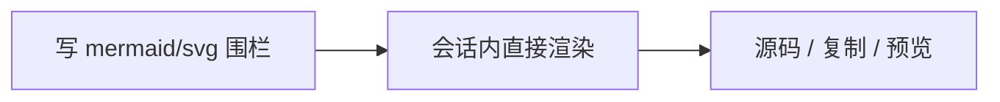

# dsh-charts


在 DSH Web 会话里把 **mermaid** 与 **svg** 代码围栏直接渲染成图表：代码即图表，不落文件、不转 PNG、不额外点开预览。



## 支持

| 围栏语言 | 渲染 |
| --- | --- |
| mermaid / mmd | Mermaid 11 引擎：流程图、时序图、类图、状态图、饼图、xychart-beta 柱状/折线图、甘特图、时间线、思维导图、象限图、桑基图、矩形树图等 |
| svg | 直接内联你写的 SVG（适合自定义统计图、排名条、示意图） |

图表本身无边框，像图片一样点击即可打开预览：

- 预览是应用内浮层（不调用系统全屏），顶部操作栏提供源码 / 复制 / 关闭，底部是缩放条；
- 支持滚轮或按钮缩放、拖动平移，Esc、点击空白处或关闭按钮退出；
- 跟随 GUI 亮/暗主题（mermaid 自动切换 default/dark，SVG 使用自身配色）；
- 流式输出期间显示源码，消息落定后再渲染，避免半截代码闪烁；
- 语法错误时保留源码并显示错误摘要，不阻塞消息其余内容；
- 视口懒渲染 + 串行队列，多图不会卡住页面；
- mermaid 引擎首次出现图表时才按需加载（约 3.5 MB，之后走浏览器缓存）。

## 安装

插件是普通 DSH bundle 包，装进 profile 后对该 profile 的所有会话生效。

从 GitHub 安装（推荐）：

```sh
dsh plugin --profile desktop add github:wunengbiao/dsh-charts
```

其他 profile 把 `desktop` 换成 `web` / `tui` 等即可。

本地开发目录安装：

```sh
dsh plugin --profile desktop add link:/Users/orion/Coding/research/dsh-charts
```

发布到 npm 后也可以：

```sh
dsh plugin --profile web add dsh-charts
```

安装会写入 profile 的 `package.json` 依赖和 `dsh.profile.bundles`。启用 HMR 的宿主会热加载；如果运行时已经缓存了被移动过的链接目标（例如插件目录改过名），需要重启一次桌面应用或 `dsh web` 让新的包解析生效。
## 配置

在 profile 的 cordis.patch.yml 里覆盖行配置：

```yaml
- id: charts
  config:
    theme: auto          # auto | default | dark | neutral | forest | base
    maxTextSize: 50000   # 单张 mermaid 文本上限
    maxEdges: 2000       # 边数上限
```

theme: auto 跟随 GUI 的亮/暗主题；固定值会覆盖自动判断。

## 工作方式

- **Host 半部**（index.js）在 /dsh-charts/mermaid/ 下按需提供本包依赖里的 Mermaid UMD 构建，并在 /dsh-charts/config.json 返回生效配置；同时向系统提示词追加一条规则：画图请求用 mermaid/svg 围栏，不写图片文件。
- **Client 半部**（client.js）通过官方的 conversation.chat.markdown.fence HOC slot 注册 mermaid、mmd、svg 三种语言层。围栏内容直接交给 React 组件渲染，不监听 DOM、不改写消息、不依赖代码块选择器。
- 代码围栏是消息的一部分，因此历史消息、重新打开会话、滚动回看都会按同样方式渲染。

## 安全

- Mermaid 固定 securityLevel: 'strict'，标签由 Mermaid 内置的 DOMPurify 清理，suppressErrorRendering 防止错误图落到页面角落。
- 手写 SVG 在内联前经过清洗：移除 script、foreignObject、on* 事件属性、javascript:/外部 href，以及 @import/外部 url()；超过 2 MB 的 SVG 拒绝渲染。
- 渲染失败只显示错误与源码，不执行任何来自消息的脚本。

## 已知限制

- 只处理助手消息里的围栏；用户消息和工具输出里的围栏仍显示为代码。
- 流式输出期间显示源码，落定后渲染。
- 极长的 mermaid 图受 maxTextSize / maxEdges 保护；超限会显示错误。
- 浏览器端渲染，需要 Web GUI；CLI / TUI 会话不渲染图表。

## 开发

```sh
cd /Users/orion/Coding/research/dsh-charts
npm test        # Node 测试：fence 注册、SVG 清洗、组件渲染、host 路由
npm run check   # 语法检查
```

目录：

```
index.js            Host：配置校验、mermaid 资源路由、系统提示词
client.js           Client：fence 层、mermaid 加载与渲染、SVG 清洗、UI
cordis.patch.yml    bundle 层（insert 一行）
locale/             插件页显示用的中英文元信息
test/               host 与 client 的 Node 测试
```

## English

Render mermaid and svg fences directly inside DSH Web conversation messages. No files, no PNG conversion, no DOM post-processing: the client registers official Markdown fence layers, lazy-loads Mermaid from a host route on first use, sanitizes hand-written SVG, and follows the GUI theme. Configure theme and size guards through the bundle row; enable it in a profile with dsh plugin --profile <name> add <path|package>.

MIT License.